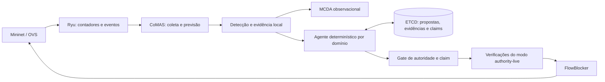
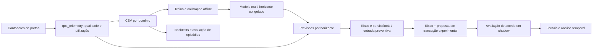

# Arquitetura atual

Este mapa descreve o código da referência
`40b60906dfa299309fd423022bb00225666d7ff6`. A estrutura de pacotes proposta no
[plano incremental](refactoring-plan.md) ainda é uma meta de reorganização.

## Serviços do testbed

Na configuração usual, dois domínios têm uma instância Ryu, um serviço
SimpleSwitch, um preditor CoMAS e um FlowBlocker por domínio. Mininet e OVS
implementam o plano de dados. Três membros ETCD replicam o estado compartilhado.

O desenho destaca a atuação autoritativa dos agentes. O runtime também conserva
o caminho local/MCDA conforme a configuração. A seleção de modo define qual
caminho pode atuar; em `authority-live`, o MCDA permanece comparador.

## Responsabilidades físicas atuais

| Área | Implementação principal | Responsabilidade |
| --- | --- | --- |
| Composição do runtime | `flow_predictor_cnsm.py` | Lê configuração, instancia engine/coletor e expõe a API Flask. |
| Previsão e detecção de tráfego | `offline_model.py`; classes `HoltPredictor`, `SeriesState` e `ResidualAnomalyDetector` no runtime | Carrega o contrato do modelo, mantém estado por série e avalia resíduos. |
| Coleta e histórico | Classes `Collector` e `PredictionHistoryExporter`; `qos_telemetry.py` | Converte contadores, preserva qualidade das amostras e exporta históricos. |
| MCDA | `collaborative_decision.py`; `CollaborativeDecisionManager` | Combina evidências e registra a decisão multicritério. |
| Propostas e deliberação | `agent_protocol.py`, `domain_agent.py`; `AgenticShadowManager` | Valida propostas e avalia a compatibilidade/quórum entre domínios. |
| Autoridade | `agent_authority.py`; verificações adicionais no runtime | Revalida a decisão e oferece o claim atômico. O módulo isolado não chama o FlowBlocker. |
| Encaminhamento e atuação | `rest_client/`, `ryu_apps/`, `flow_blocker/` | Instala encaminhamento e converte pedidos autorizados em políticas OpenFlow. |
| API | Rotas `/predictor/*` no runtime | Expõe status, modelo, previsões, evidências, feedback e configuração. |

Os diretórios de serviços incluem código de terceiros com avisos próprios.
Uma limpeza futura deve verificar uso e origem antes de remover ou substituir
esses arquivos.

## Consenso de domínio e consenso do armazenamento

O acordo dos agentes exige propostas compatíveis para o fluxo, modelo, tempo
e topologia relevantes. `AGREED` é um estado deliberativo; a autorização e o
claim são etapas posteriores.

Os três membros ETCD usam Raft para replicar o armazenamento. A maioria de dois
membros de um cluster de três é uma propriedade dessa camada. Esses membros
não são três votos de domínio nem tornam uma proposta incompatível aceitável.

## Linha experimental de SLA

`qos_holt.py` e `qos_damped_holt.py` representam modelos e previsores.
`sla_risk.py`, `sla_episode_evaluation.py` e os avaliadores de campanhas
definem risco, persistência, episódios observados e correspondência de avisos.
Os módulos `predictive_sla_validation*` e `predictive_sla_shadow*` mantêm
protocolos e análises versionados.

A publicação shadow usa namespace ETCD experimental e não entrega uma
autorização ao caminho de atuação. Os scripts do piloto controlam a ligação
entre telemetria, modelo e proposta; não existe um caminho preventivo completo
promovido para produção.

## Auditoria posterior

`llm_auditor/` lê metadados, resumo e timeline de execuções concluídas.
Adaptadores normalizam os eventos, regras determinísticas emitem vereditos e
certificados conservam a ligação com as evidências.

Ollama é opcional para explicações e avaliações experimentais. A aceitação
estrutural de uma saída não constitui verificação independente da verdade da
prosa. Narrativas suplementares continuam exigindo revisão factual.

Não há chamada à LLM no gate de autoridade nem um árbitro LLM implementado para
resolver desacordo dos agentes. Esse é um objetivo futuro que exige contrato,
política, orçamento de tempo e validação próprios.

## Dados e proveniência

- Modelos incluídos em `models/` são artefatos versionados de referência.
- Históricos e campanhas reais ficam fora do código, em diretórios ignorados
  pelo Git como `experiments/results/` e `prediction_history/`.
- Protocolos congelados registram hashes de modelos, dados e arquivos de código;
  alguns também exigem caminhos absolutos e diretórios irmãos específicos.
- Relatórios offline preservam falhas, fontes incompletas e resultados
  desconhecidos. Reorganizar o código não transforma esses estados em sucesso.

Essas dependências são o motivo para separar primeiro documentação e inventário,
antes de alterar a composição dos módulos. O procedimento de comparação está
em [reproducibility.md](reproducibility.md).
